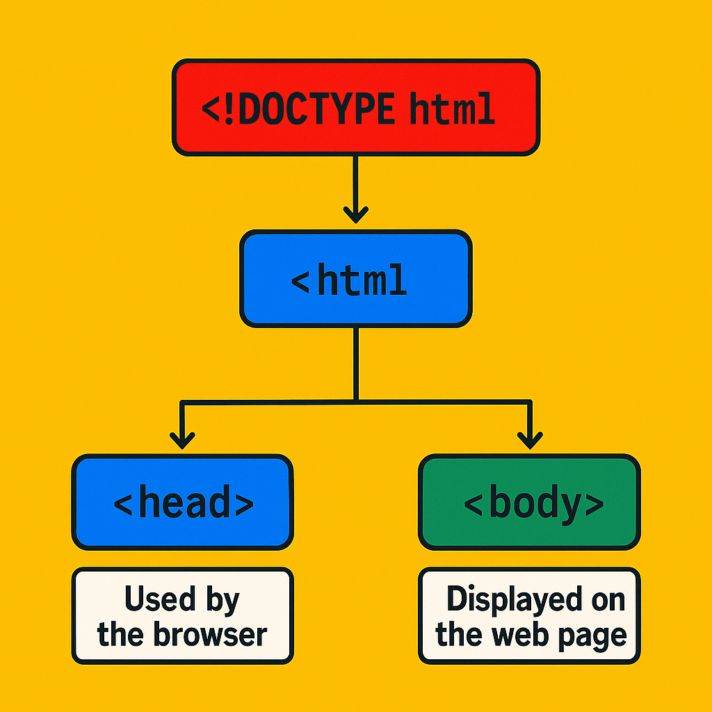
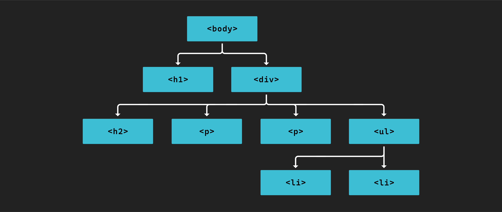
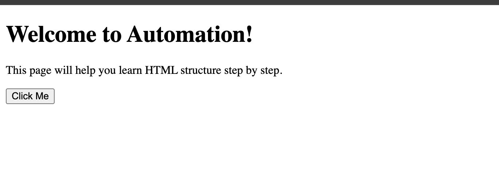

<h1>
  <span class="headline">Pre-Selenium: Basic HTML Structure & Elements</span>
  <span class="subhead">Anatomy of an HTML document</span>
</h1>

**Learning Objective:** Identify the purpose and layout of a basic HTML document, including `<html>`, `<head>`, and `<body>`.

## Overview of the HTML document structure

Every page you visit on the web—whether it is a simple profile, an online store, or a software dashboard—rests on a foundational set of instructions called an _HTML document_. You might think of HTML as the _blueprint_ or _skeleton_ of every webpage.

A browser reads an HTML file and builds the web page you see, following specific rules that ensure consistency across different pages and browsers.

A basic HTML document includes three critical building blocks:

- The `<!DOCTYPE html>` declaration, which announces the document type to the browser.
- The root `<html>` tag, containing all the content and structure.
- Two major sections inside `<html>`: `<head>` for meta-information, and `<body>` for all visible content.



<br>

Here’s the simplest structure you will encounter:

```html
<!DOCTYPE html>
<html>
  <head>
    <title>Page Title</title>
  </head>
  <body>
    <h1>Hello, HTML!</h1>
    <p>Welcome to your new page.</p>
  </body>
</html>
```

> 📚 The _DOM_ (Document Object Model) represents how browsers interpret your HTML, turning code into a tree of elements you can inspect and automate.

## Understanding the `<html>` tag and its significance

The `<html>` element is the root container for everything in your web page. Anything you want to include—visible or not—must go inside this tag. A helpful comparison is to think of your project directory: just as all scripts, assets, and resources live in a project’s top-level folder, all parts of a webpage must nest within `<html>`.

You may sometimes see the `<html>` tag with a _lang_ attribute (for example, `<html lang="en">`). This specifies the content’s language, which supports accessibility tools and browsers but does not change how the core structure works for automation.

```html
<html lang="en">
  <!-- Head and body content go here -->
</html>
```

> 💡 For automation with Selenium, always expect every target element to live somewhere within this root structure.

## Exploring the `<head>` section and its typical elements

Inside `<html>`, the `<head>` section is your chance to set the stage—providing crucial background details and instructions that shape the way the page loads in browsers and appears to users, but that are not directly visible on the page.

If you have ever used configuration files, environment variables, or decorators in Python, you are already familiar with separating _setup_ details from main program logic. `<head>` plays a similar role by organizing settings for your web page.

Some common elements inside `<head>`:

- `<title>` sets the name shown in browser tabs.
- `<meta>` conveys page details (such as character encoding), helping search engines and improving accessibility.
- `<link>` pulls in external files like CSS for design or icons.
- `<script>` (less common in simple examples) can reference JavaScript needed before the content appears.

Example:

```html
<head>
  <title>My HTML Demo</title>
  <meta charset="UTF-8" />
</head>
```

> 🧠 You will rarely need to automate actions within `<head>`, but knowing what is inside can help you troubleshoot page loading issues or locate resources that affect test results.

## Introduction to the `<body>` section and its role in displaying content



The `<body>` section holds everything users see and interact with: headings, paragraphs, buttons, forms, navigation links, and more. In your automation workflow, this is where you will spend most of your time.

```html
<body>
  <h1>Welcome to Automation!</h1>
  <p>This page will help you learn HTML structure step by step.</p>
  <button>Click Me</button>
</body>
```

When a browser loads your web page, everything inside `<body>` is displayed and can be interacted with—making it the main focus for test automation using Selenium or other tools.



> 💡 Most element selection, clicking, and form filling for browser automation targets elements within `<body>`.

<div class="activity solo-exercise">
  <h2 class="title">Reviewing a simple HTML document</h2>
  <span class="minutes">5 min</span>
</div>

Now that you understand the building blocks, let’s connect theory to practice. You will explore, view, and manipulate these structures in both your code editor and browser using familiar tooling.

1. **Open a project folder**  
   Open VS Code and navigate to your `html-basics` folder.

2. **Create or locate your example HTML file**

   - Open your existing `index.html` or create a new file named `structure-demo.html`.

3. **Paste in the following HTML document:**

   ```html
   <!DOCTYPE html>
   <html lang="en">
     <head>
       <title>HTML Structure Exploration</title>
       <meta charset="UTF-8">
     </head>
     <body>
       <h1>Hello from the HTML <body>!</h1>
       <p>This paragraph is inside the body. Try editing me!</p>
     </body>
   </html>
   ```

4. **Save your file**

   - Use <kbd>Control</kbd> + <kbd>S</kbd> (Windows/Linux) or <kbd>Command</kbd> + <kbd>S</kbd> (Mac).

5. **Open your HTML in a browser**

   - Locate `structure-demo.html` in your file explorer.
   - Double-click to open in your browser.
   - Observe the page title (from `<title>`) on the browser tab and the heading/paragraph (from `<body>`) on the page.
   - Practice making changes to your file, saving, and refreshing the browser page to see those changes live.

> 🏆 Mastery of DOM structure and browser tools will make test automation more predictable and effective.
