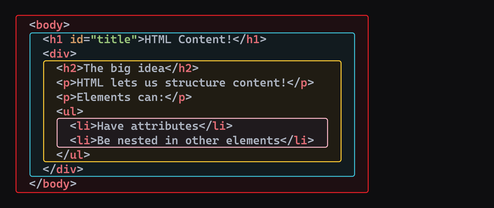

<h1>
  <span class="headline">Pre-Selenium: Basic HTML Structure & Elements</span>
  <span class="subhead">Common HTML elements for test automation</span>
</h1>

**Learning objective:** Recognize and explain the role of common HTML elements like `<div>`, `<span>`, `<input>`, `<button>`, `<form>`, and `<a>`.

## Why these elements matter for automation

When automating browser actions, it is important to recognize the core building blocks of a web page. These elements—such as forms, buttons, and containers—form the targets for many automated tests. If you have experience manipulating data in Python, you already think methodically about data structures. HTML works the same way, just visually.

> 💡 Building HTML fluency helps you quickly identify which elements to automate, making your test scripts more robust and your troubleshooting faster.



## Overview of block-level elements

Some HTML elements, known as _block-level elements_, appear on a new line and extend the full available width. They provide structure to the content, similar to how sections or headers in documentation organize information.

### The `<div>` element

The `<div>` (short for "division") is the foundation for grouping content in block-level containers. It does not add any specific meaning by itself, but it is extremely flexible for structuring layouts or for targeting with styles and scripts.

**Example:**

```html
<div>
  <h2>News</h2>
  <p>Latest updates appear here.</p>
</div>
```

> 🏆 A `<div>` is like a storage bin in a warehouse—it is useful for organizing things, even if the bin itself does not say what it holds. Use `<div>` to collect related content into logical sections, especially when there is no built-in semantic tag for your purpose.

### Other block-level elements

Elements such as `<p>` for paragraphs and `<h1>` through `<h6>` for headings provide structure and hierarchy to your content. These elements are not only visually significant; they help browsers and assistive tools understand the main topics and subtopics within the page.

**Example:**

```html
<h1>Project Title</h1>
<p>This project demonstrates semantic HTML.</p>
```

> 💡 For test automation, structured headings and paragraphs make it easier to target text or sections—for example, to verify expected content appears on a web page.

## Overview of inline elements

Unlike block-level elements, _inline elements_ fit within a line of text. They do not start on a new line and are perfect for organizing smaller pieces of content, such as highlights, links, or labels.

### The `<span>` element

`<span>` is the go-to generic inline element. It adds no extra meaning but allows you to target specific text within a block for styling or scripting.

**Example:**

```html
<p>Server status: <span class="online">Online</span></p>
```

> 🧠 `<span>` is like a label on a box—it does not alter the box, but it lets you identify it quickly. Use `<span>` tags to wrap and style or interact with small snippets of text without interfering with the rest.

### The `<a>` (anchor) element

The `<a>` element, also called an anchor tag, creates hyperlinks to other pages or resources. It uses the `href` attribute to define the destination.

**Example:** Navigation link

```html
<a href="https://generalassemb.ly">Learn tech skills</a>
```

A key attribute is `href` (hypertext reference), which tells the browser where to go when the link is clicked.

> 💡 In automation, knowing how to identify `<a>` elements is critical for mimicking user navigation. For example, clicking a login link or navigating to a different section.

### Other inline elements

There are several other inline elements like `<strong>` (for strong emphasis, usually bold), `<em>` (for emphasized text, usually italic), and `<code>` (for displaying code). However, in automation and DOM exploration, `<span>` and `<a>` will be two of your most common targets.

## Form elements

Automated testing often interacts with input fields, buttons, and forms—places where users submit data or trigger actions. Recognizing their structure helps you target the right elements every time.

### The `<input>` element

The `<input>` element collects user data. Its behavior is controlled by the `type` attribute.

**Common attributes:**

- `type`: Describes the kind of data (`text`, `email`, `checkbox`, and more).
- `name`: Acts as the dictionary key, labeling the data when submitted.
- `value`: Holds the current or initial value.

**Example:** Text and password inputs

```html
<input type="text" name="username" /> <input type="password" name="password" />
```

| `<input>` Type | Common Use                                 | Real-World Scenario                         |
| -------------- | ------------------------------------------ | ------------------------------------------- |
| `text`         | Single-line text input                     | Entering a username or full name in a form  |
| `password`     | Obscured input for sensitive data          | Typing a password during login              |
| `email`        | Validated email address input              | Signing up for a newsletter or account      |
| `number`       | Numeric input with optional min/max values | Selecting quantity in an online cart        |
| `checkbox`     | Select one or more options                 | Agreeing to terms of service or preferences |
| `radio`        | Select one option from a group             | Choosing gender or payment method           |
| `submit`       | Sends form data to a server                | Clicking “Log In” or “Register”             |
| `search`       | Input designed for search queries          | Typing a product name in an e-commerce site |
| `date`         | Selecting a specific calendar date         | Booking a check-in date for a hotel         |
| `file`         | Uploading a file from the user’s device    | Attaching a resume to a job application     |

> 🏆 When you need to automatically enter data as part of a test, pinpointing the right `<input>` element by its attributes will save time and avoid errors.

### The `<button>` element

The `<button>` element creates clickable triggers for actions like submitting a form, starting a process, or navigating to a new section.

**Example:**

```html
<button type="submit">Sign In</button>
```

You may also see buttons outside of forms for actions such as opening menus or starting different workflows. Always check their context and attributes.

> 💡 In a Python script, you might call a function when a condition is met. In HTML, clicking a button can trigger actions—such as submitting a form—making `<button>` a frequent automation target.

### The `<form>` element

A `<form>` bundles inputs and controls into a single unit for submission. It uses attributes like `action` to define where data is sent and `method` to determine how it is sent (for example, GET or POST).

**Example:**

```html
<form action="/search" method="get">
  <input type="text" name="q" />
  <button type="submit">Search</button>
</form>
```

> 💡 Identifying the boundaries of a `<form>` in the HTML helps ensure your scripts fill out and submit data only within the intended context, avoiding accidental actions elsewhere on the page.

## All together: Sample HTML with common elements

Let’s look at a realistic example that brings these elements together as you might find them on a real page.

<code class="filepath">elements-practice.html</code>

```html
<!DOCTYPE html>
<html lang="en">
  <head>
    <meta charset="UTF-8" />
    <title>Sample Automation Page</title>
  </head>
  <body>
    <div>
      <h2>Welcome!</h2>
      <p>Please <a href="https://example.com/login">log in</a> to continue.</p>
    </div>
    <form>
      <label for="user">Username:</label>
      <input type="text" id="user" name="username" />

      <label for="pw">Password:</label>
      <input type="password" id="pw" name="password" />

      <button type="submit">Log In</button>
    </form>
    <span
      >Need an account?
      <a href="https://example.com/signup">Sign up here</a>.</span
    >
  </body>
</html>
```

> 💡 When you open this file in a browser and inspect it with DevTools, try clicking each element. Notice how their roles in the code mirror their roles in the user experience—a direct link between structure and behavior.

<div class="activity guided-walkthrough">
  <h2 class="title">Hands-on element identification</h2>
  <span class="minutes">8 min</span>
</div>

1. **Create a sample file**

   - In your project folder (such as <code class="filepath">selenium-html-practice</code>), add a new file called <code class="filepath">elements-practice.html</code>.

2. **Copy the code above**

   - Paste the Sample Automation Page code into your new file.

3. **Open it in your browser**

   - In VS Code’s Explorer pane, right-click <code class="filepath">elements-practice.html</code> and choose **Reveal in File Explorer** (Windows), **Reveal in Finder** (Mac), or your default file browser.
   - Double-click the file to open in Chrome

4. **Inspect elements with DevTools**

   - Right-click anywhere on the page and select **Inspect** to open DevTools.
   - In the _Elements_ panel, expand the `<body>` and click on each of the following elements: `<div>`, `<span>`, `<input>`, `<button>`, `<form>`, and `<a>`.

5. **Explore each Element:**

   - What is the tag name?
   - What content or elements does it contain?
   - What purpose does it serve on this page?
   - Does it use any key attributes, such as `type`, `name`, or `href`?

<div class="activity discussion">
  <h2 class="title">Automating a Login Process</h2>
  <span class="minutes">5 min</span>
</div>

Imagine you are automating a login process. Based on your inspection of the sample HTML file:

- Which attributes on the `<input>` tags would you use to target them in a Selenium script?
- How would you identify the submit `<button>` to automate a click?
- What might be challenging about identifying the right `<div>` or `<span>`?
