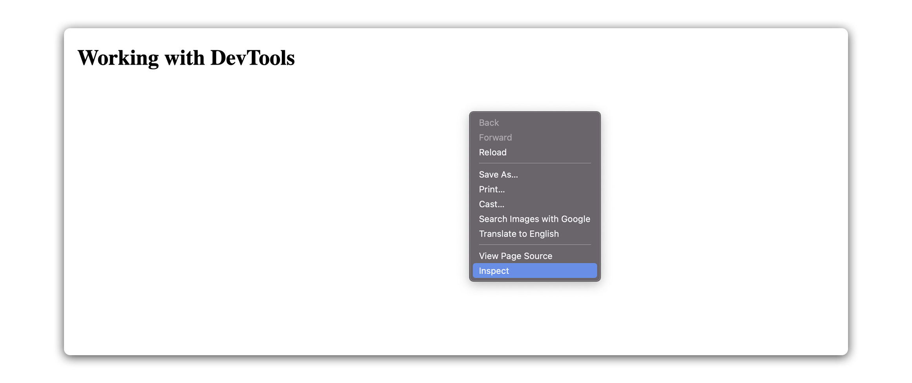
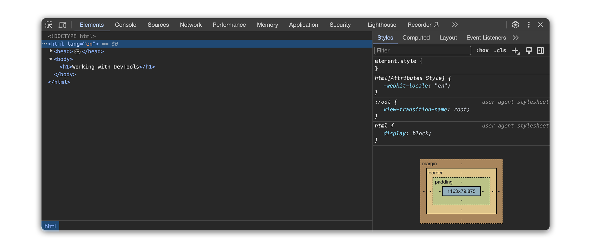
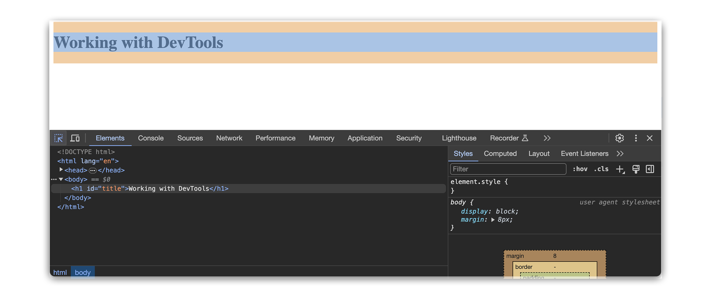

<h1>
  <span class="headline">Pre-Selenium: Basic HTML Structure & Elements</span>
  <span class="subhead">Exploring HTML with Chrome DevTools</span>
</h1>

**Learning Objective:** Use Chrome DevTools to inspect and explore the structure of a rendered webpage.

## Introduction to Chrome DevTools interface

As a Python developer, you are familiar with reading code and tracing program flow. When working with web pages, though, not everything is visible within your text editor. Browsers interpret the HTML, apply styles, and sometimes update the page using scripts.

_Chrome DevTools_ gives you access to what is really happening—revealing the live structure behind every website. This type of exploration becomes your secret superpower in test automation, allowing you to understand and target elements confidently, no matter how complex a page may look.

### Why is this valuable for automation?

When automating browser tasks with tools like Selenium, you need to know how to **locate and understand HTML elements**. DevTools empowers you to confidently investigate, identify, and target the right pieces of the page for your scripts.

To open Chrome DevTools on any webpage:

- **Right-click** anywhere on the page and select **"Inspect"**.
- Or use the keyboard shortcut: **Ctrl** + **Shift** + **I** (on Windows) or **Cmd** + **Option** + **I** (on Mac).



> 💡 If you’ve debugged Python using print statements or IDE debuggers, think of DevTools as your way to “print” the entire web page structure live, seeing not just your own code, but how the browser interprets and displays it.

## Navigating to the Elements panel

DevTools includes several panels—each designed for a distinct part of a webpage’s behavior (like code, network activity, or performance). For exploring HTML, our focus is the **Elements** panel.

The Elements panel displays your page as a **tree structure** called the _DOM_ (Document Object Model). This is how the browser actually understands and manipulates your HTML.

### What can you do in the Elements panel?

- **View the complete HTML structure** as the browser understands it.
- **See live updates** as the page changes or when you manually edit a tag.
- **Hover over any element** in the DOM tree to highlight its visual position on the page.
- **Expand/collapse nodes** to dig deeper into the structure, just like folding and unfolding folders in your code editor.
- **Examine or temporarily edit attributes** (like `class`, `id`, or `type`) to see immediate effects.



> 🏆 Navigating the Elements panel is essential for quickly finding exactly which code generates a button, input field, or section you want to automate. Mastering this view is key for effective browser automation.

## Inspecting individual HTML elements

Just as you might inspect a particular Python variable by name or print its contents, in DevTools you can zero in on a specific element on the page.

Here’s how:

- **Expand and collapse elements** using the arrows next to tags, similar to how you explore folders or files in VS Code.
- **Hover over tag names** to see the part of the page they control, highlighted in real-time.
- **Click elements** in the DOM tree to bring up their attributes and see more details or make direct edits.

### Using the Element Picker

The **Element Picker** is one of the most powerful features in DevTools. You can:

1. Click the **Element Picker** icon (it looks like a mouse cursor in a square, usually in the top-left of DevTools).
2. Hover over any visible part of the web page—the corresponding element in the DOM tree is highlighted.
3. Click on a feature (for example, a button or link) to have DevTools jump directly to the code handling that piece.



**Example:**

- Want to know which `<button>` tag supports the "Sign In" label? Use the Element Picker, click on the button, and DevTools selects it for you in the DOM tree.
- Unsure of which `<input>` a particular form field belongs to? Use the Picker, then see how it’s organized in relation to its parent `<form>` or sibling elements.

### Breadcrumb navigation

- At the bottom of the Elements panel, a breadcrumb trail (like `html > body > div > form > input`) shows the path to the currently selected element.
- You can quickly navigate "up" or "down" the page structure by clicking any element in this breadcrumb.

## Linking HTML source code with rendered content

You have already built and saved HTML files in VS Code, then opened them in Chrome. What happens between your written code and what’s displayed?

The process looks like this:

1. **Write or edit HTML code** in your editor (such as `<input type="email" name="useremail">`).
2. **Open or refresh your file** in Chrome. The browser reads your HTML, builds a live DOM (what DevTools displays), and renders the page visually.
3. **Inspect with DevTools**. You can see and interact with this live DOM, viewing all current tags, attributes, and even dynamic changes from JavaScript.
4. **Edit in DevTools**. Changes made here (like changing an element’s text or class) appear instantly, but **do not** update your source file—think of them as temporary experiments.
5. **Change in VS Code and reload**. Any saved edits are picked up again by the browser after a refresh.

<div class="activity solo-exercise">
  <h2 class="title">Using DevTools to inspect a live webpage</h2>
  <span class="minutes">5 min</span>
</div>

Strengthen your skills by inspecting, editing, and understanding live pages using Chrome DevTools. You will practice the same workflows used for effective browser automation.

1. **Create your practice file**  
   In your <code class="filepath">selenium-html-practice</code> folder, create a new file called <code class="filepath">devtools-demo.html</code>.

2. **Paste the following HTML into your file:**

   <code class="filepath">devtools-demo.html</code>

   ```html
   <!DOCTYPE html>
   <html lang="en">
     <head>
       <meta charset="UTF-8" />
       <title>DevTools Exploration</title>
     </head>
     <body>
       <div>
         <h2>DevTools Demo Page</h2>
         <p>
           Try inspecting this
           <a href="https://example.com/docs">documentation link</a> for more
           info.
         </p>
       </div>
       <form>
         <label for="user">Username:</label>
         <input type="text" id="user" name="username" />

         <label for="pw">Password:</label>
         <input type="password" id="pw" name="password" />

         <button type="submit">Submit</button>
       </form>
       <span
         >Looking for help?
         <a href="https://example.com/help">Contact support</a>.</span
       >
     </body>
   </html>
   ```

   Save your file.

3. **Open your page in Chrome**  
   Find <code class="filepath">devtools-demo.html</code> in your file manager and open it in Chrome.

4. **Open DevTools**  
   Right-click anywhere on the page and select **Inspect**.

5. **Explore the DOM structure**

   - Expand `<html>`, then `<body>`.
   - Click and explore the nested `<div>`, `<form>`, and `<span>` elements.
   - Click any `<a>` tag. Notice which link is highlighted.

6. **Use the breadcrumb trail**

   - After selecting an `<a>` inside a paragraph, find the breadcrumb trail at the bottom.
   - Click “p” or “div” in the breadcrumb to move up the hierarchy.
   - Observe how both the highlighting and selection change.

7. **Edit live HTML**

   - Double-click the “Contact support” link text inside the `<span>` and change it to `Get assistance`. Press Enter.
   - Watch the update appear right away on the page.

8. **Try the element selector tool**
   - Click the arrow icon at the top-left of DevTools.
   - Hover over different elements (inputs, buttons, links) on your page. Note how each item is highlighted and located in the Elements panel.

<div class="activity discussion">
  <h2 class="title">Exploring Dev Tools</h2>
  <span class="minutes">2 min</span>
</div>

While exploring with DevTools, what feature or workflow helped you most in connecting the code from your editor to the browser’s live structure? Did any element behave differently or appear somewhere unexpected compared to what you assumed from reading the code?

Imagine you are preparing a Selenium automation that needs to target a form input or click a specific button. How can the skills you practiced today help you reliably select those elements, especially if you are working with unfamiliar or dynamically-generated pages?
