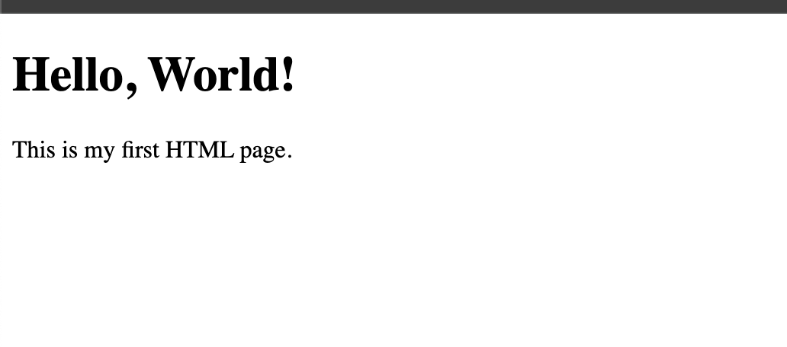

<h1>
  <span class="headline">Pre-Selenium: Basic HTML Structure & Elements</span>
  <span class="subhead">Setup</span>
</h1>

## Setup

**Learning objective:** Create a basic HTML project using VS Code and save simple HTML files locally.

## Getting oriented

As someone who codes in Python, you may have set up and run scripts many times. But when working with HTML, your approach shifts slightly—your code does not run in a terminal, but is _viewed_ and interpreted visually by a browser.

> 💡 If you’re used to working with directories for Python projects, you’ll find the folder approach for HTML instantly familiar. The main difference: you will _see your work directly_ in a browser, not through console output.

## Creating your first HTML project

A well-structured workspace is the foundation of any coding project—Python, HTML, or otherwise.

1. **Choose a home for your new project**  
   Select a directory on your machine—your <code class="filepath">Desktop</code>, <code class="filepath">Documents</code>, or wherever you prefer to keep code projects.

2. **Create a project folder**  
   Give it a clear name like <code class="filepath">html-basics</code> or something that makes sense to you.

3. **Open the folder in VS Code**

   - Open VS Code.
   - Go to the menu and select **File > Open Folder…**, then locate and select your new project folder.
   - You’ll see your project listed in the Explorer pane.

4. **Add an HTML file**
   - Right-click the folder within the Explorer pane.
   - Select **New File**.
   - Name your file <code class="filepath">index.html</code>—this is a common convention for the main HTML page of a web project.

> 🏆 Consistency in naming files (like always having an <code class="filepath">index.html</code> or <code class="filepath">main.py</code>) helps both humans and programs know where to start.

## Boilerplate in HTML

Every HTML page begins with a basic template—often called the _HTML boilerplate_. Consider it like scaffolding for a building: it provides vital structure, even if your “building” (web page) is currently empty.

Below is the standard HTML boilerplate. Each part serves a technical purpose, but their intent is straightforward:

<code class="filepath">index.html</code>

```html
<!DOCTYPE html>
<html lang="en">
  <head>
    <meta charset="UTF-8" />
    <title>My First HTML Page</title>
  </head>
  <body>
    <!-- Page content goes here -->
  </body>
</html>
```

Let’s map each piece to its role:

- `<!DOCTYPE html>`: Signals to the browser that you’re writing modern HTML5.
- `<html lang="en">`: Wraps your entire page; _lang_ assists with accessibility and search engines.
- `<head>`: Hidden content for the browser: page settings, encoding, title.
- `<meta charset="UTF-8" />`: Ensures your text displays as intended for all languages.
- `<title>`: Appears as the tab label in your browser.
- `<body>`: Where your visible page content lives.

> 📚 The “boilerplate” is a _template_—reusable code that kickstarts your page structure.

**Try it now:**

Copy and paste the above code into your <code class="filepath">index.html</code> file, then save it.

## Viewing in the browser

Update the `<body>` of your HTML file to:

```html
<body>
  <h1>Hello, World!</h1>
  <p>This is my first HTML page.</p>
</body>
```

- `<h1>` is a large heading—think of it like `#` in Markdown.
- `<p>` creates a paragraph.

**Viewing your page:**

- Save your <code class="filepath">index.html</code>.
- In VS Code, right-click on the file name and select **Reveal in File Explorer** (Windows) or **Reveal in Finder** (Mac).
- Double-click <code class="filepath">index.html</code>. Your web browser (such as Chrome) will open and display your page.

> 💡 Unlike terminal output from a Python script, you’re now seeing the _live_ result of your HTML code rendered visually. If you make changes, just save the file and refresh the browser window.



## Why this matters for automation

As you prepare to automate browser interactions, being able to quickly identify and understand how web content is structured gives you a practical advantage. When you work with Selenium and need to interact with an element, your fluency in recognizing tags like `<h1>`, `<p>`, or `<button>` means less time spent searching and more time writing effective tests.

<div class="activity solo-exercise">
  <h2 class="title">Set up and inspect a custom HTML page</h2>
  <span class="minutes">3 min</span>
</div>

Cement your understanding of project structure and HTML essentials by setting up and customizing another practice page.

1. **Create a new project folder**

   - Name it <code class="filepath">selenium-html-practice</code> or another descriptive name.
   - Open it in VS Code.

2. **Add a new HTML file**

   - Name the file <code class="filepath">practice.html</code>.

3. **Add and adjust boilerplate**

   - Paste in the standard HTML boilerplate.
   - Change the `<title>` in your `<head>` to <code>Selenium Practice Page</code>.

4. **Personalize your page**

   - Inside `<body>`, add an `<h2>` heading with: Automating with Selenium Starts Here!
   - Below that, add a `<p>` element. Introduce yourself or share a bit about your coding interests.  
     Example:
     ```html
     <body>
       <h2>Automating with Selenium Starts Here!</h2>
       <p>I'm a Python developer practicing HTML for test automation.</p>
     </body>
     ```

5. **View your results**

   - Save the file.
   - Locate <code class="filepath">practice.html</code> in your file system and double-click to open with your browser.

6. **Explore using browser tools**
   - With the page open, right-click and choose **Inspect** (or **Inspect Element**) to open Chrome DevTools (or the equivalent in your browser).
   - Hover over different elements in the _Elements_ panel to see which parts of your code relate to sections of the page.

> ❓ When inspecting your HTML page in the browser, was there anything about the structure or the workflow that felt intuitive or unexpected compared to your experience with Python? How might this hands-on setup support your troubleshooting when automating browser actions?
